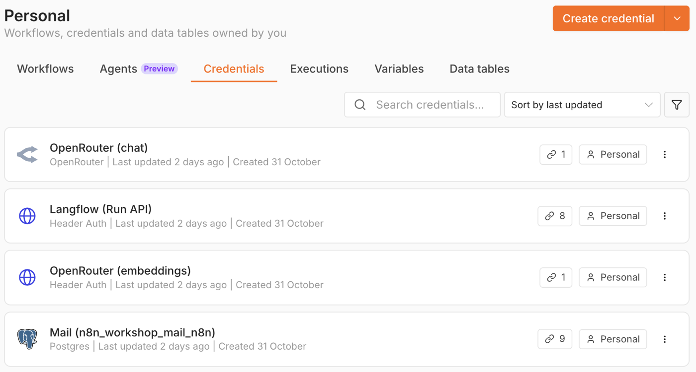
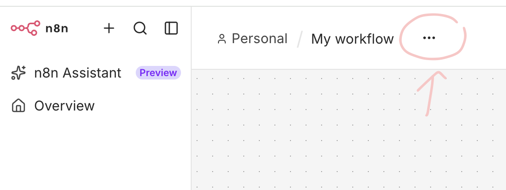
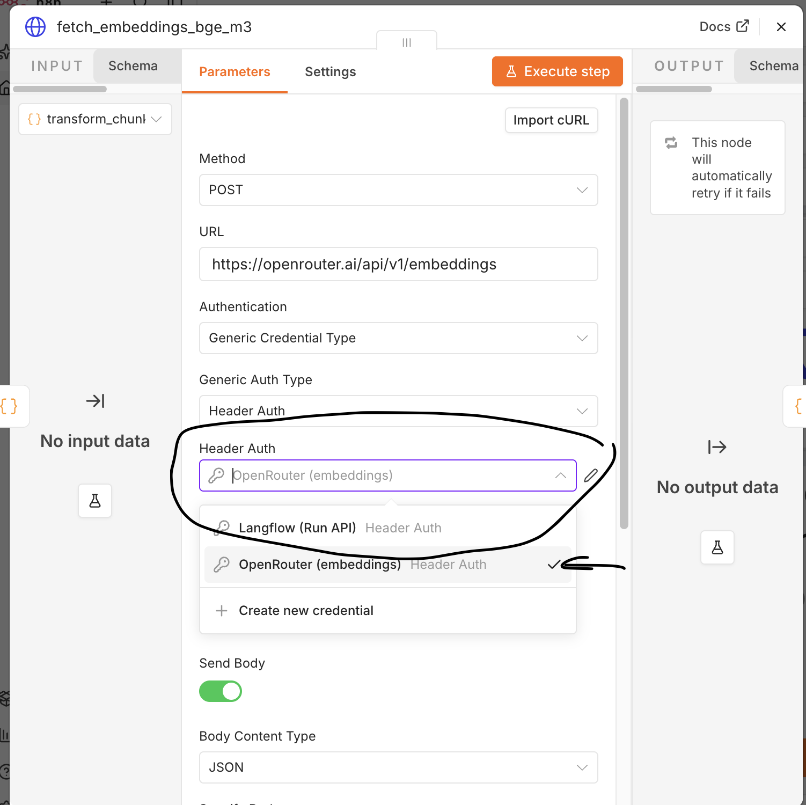

<figure class="bp bp-setup bp-mini" aria-label="Where you are: Part C"><div class="bp-sys"><div class="bp-node mail done"><span class="bp-disc"><svg viewBox="0 0 24 24" aria-hidden="true"><rect x="3" y="5" width="18" height="14" rx="2"/><path d="m3 7 9 6 9-6"/></svg></span><b>Gmail</b><span>your test Gmail account</span><em>Part A · steps 1–7 ✓</em></div><div class="bp-node box done"><span class="bp-disc"><svg viewBox="0 0 24 24" aria-hidden="true"><rect x="3" y="4" width="18" height="7" rx="1.5"/><rect x="3" y="13" width="18" height="7" rx="1.5"/><path d="M7 7.5h.01M7 16.5h.01"/></svg></span><b>Mail</b><span>kingo-pod's service: copies the mails, masks addresses</span><em>Part A · steps 1–7 ✓</em></div><div class="bp-node db done"><span class="bp-disc"><svg viewBox="0 0 24 24" aria-hidden="true"><ellipse cx="12" cy="5" rx="8" ry="3"/><path d="M4 5v14c0 1.7 3.6 3 8 3s8-1.3 8-3V5"/><path d="M4 12c0 1.7 3.6 3 8 3s8-1.3 8-3"/></svg></span><b>PostgreSQL</b><span>every mail as a row</span><em>Part A · steps 1–7 ✓</em></div><div class="bp-node muscle now"><span class="bp-disc"><svg viewBox="0 0 24 24" aria-hidden="true"><rect x="2.5" y="9" width="5" height="6" rx="1.2"/><rect x="16.5" y="3" width="5" height="6" rx="1.2"/><rect x="16.5" y="15" width="5" height="6" rx="1.2"/><path d="M7.5 12H11M11 12V6h5.5M11 12v6h5.5"/></svg></span><b>n8n</b><span>does the work</span><em>Part C · steps 9–13 · you are here</em></div><div class="bp-node brain done"><span class="bp-disc"><svg viewBox="0 0 24 24" aria-hidden="true"><path d="M12 3l1.9 4.6 4.6 1.9-4.6 1.9L12 16l-1.9-4.6-4.6-1.9 4.6-1.9z"/><path d="M18.5 15.5l.8 1.9 1.9.8-1.9.8-.8 1.9-.8-1.9-1.9-.8 1.9-.8z"/></svg></span><b>Langflow</b><span>thinks: sorts and drafts</span><em>Part B · step 8 ✓</em></div><div class="bp-part pa done">Part A · steps 1–7 ✓</div><div class="bp-part pc now">Part C · steps 9–13 · you are here</div><div class="bp-part pb done">Part B · step 8 ✓</div></div></figure>

n8n is the second tool of the course. In n8n you build **workflows**. A workflow is like a flow in Langflow: boxes
(nodes) joined by lines. The difference: Langflow is good for building AI; n8n is good for doing things. An n8n
workflow starts by itself (for example when a new mail arrives), passes data from box to box, asks Langflow, and acts,
for example in Gmail.

We name our workflows `WS2.0`, `WS2.1`, and so on: `WS2` stands for Workshop II, the number for the step of the
course. `WS2.0` is the first one; you import it in step 10. On 9 November, you will build more.

### 9. Open n8n and give it its logins: four credentials

Langflow and n8n each keep their own keys:
- **Langflow** keeps your OpenRouter key as a global variable (step 8.1). With it, Langflow can use the AI.
- **n8n** keeps its keys and passwords as **credentials**. A credential is a login that n8n saves for you, like an
  entry in a password manager. You make it once, and every workflow that needs it finds it by its name.

n8n needs four credentials. One of them lets n8n use your Langflow flows: for it, Langflow gives n8n a key of its own.

1. **Open n8n and make your account.** Open <http://localhost:5678>. The first time, n8n asks you to make an account.
   It lives only on your laptop.
   - *Set up owner account*: Email (for example the address of your test Gmail account), First Name, Last Name, and a
     Password with 8 or more characters, at least 1 number and 1 capital letter. Write the password down: n8n asks for
     it when you sign in again. Click **Next**.
   - *Customize n8n to you*: answer the questions as you like, then click **Get started**.
   - *Get paid features for free (forever)*: click **Skip**. The course does not need them.
   - n8n shows *Sign in* instead? Then you made an account before: sign in with it.
2. **Make a key in Langflow for n8n.** Switch to the browser window of Langflow. There, go to the profile icon in the
   top right → **Settings** → **Langflow API Keys** → **Add New** (top right). In the window *Create API Key*:
   - Description: `n8n`, so you know later what the key is for.
   - If the window also shows an expiration date, leave it empty (*No expiration*). Then the key works for the whole
     course.

   Click **Generate API Key**. Copy the key and keep it somewhere you can find it again: Langflow shows it only once.
   You need it in step 9.3.
3. **Make the four credentials in n8n.** Now you make four credentials, one after the other: one for kingo-pod's
   database, one for your Langflow flows, and two for OpenRouter. You make each one the same way:
   1. In n8n, click the **+** at the very top left, then **New credential**. A window opens: *Add new credential*,
      *Select an app or service to connect to*.
   2. Type the credential's type into the search box (for example `Postgres`), pick it, and click **Continue**.
   3. **First give the credential its name.** At the top left of the next window, n8n has put a name of its own, for
      example *Postgres account* or *Header Auth account*. Click that name, delete it, and type the name from the list
      below (*Top left*). Use exactly these names: the workflows you import later look for them by name.
   4. Fill in the fields and click **Save** (top right). Then close the window.

   - **Credential 1 of 4: give n8n access to kingo-pod's database**
     - Type: *Postgres*
     - Top left: `Mail (n8n_workshop_mail_n8n)`
     - Host: `postgres`
     - Database: `classroom`
     - User: `n8n_workshop_mail_n8n`
     - Password: `kingo2026`
     - Port: `5432`
     - SSL: `disable`
   - **Credential 2 of 4: give n8n access to your Langflow flows**
     - Type: *Header Auth*
     - Top left: `Langflow (Run API)`
     - Name: `x-api-key`
     - Value: the Langflow key from step 9.2
   - **Credential 3 of 4: give n8n access to OpenRouter, to make the mails searchable (WS2.0)**
     - Type: *Header Auth*
     - Top left: `OpenRouter (embeddings)`
     - Name: `Authorization`
     - Value: type the word `Bearer`, then one space (press the space bar once), then paste your OpenRouter key.
       With your own key, it looks like this: `Bearer sk-or-v1-0a1b2c3d…`
   - **Credential 4 of 4: give n8n access to OpenRouter's chat models, for the guard (9 November)**
     - Type: *OpenRouter*
     - Top left: `OpenRouter (chat)`
     - API Key: your OpenRouter key

   <details class="more">
   <summary>Why two for OpenRouter?</summary>

   It is the same key twice. WS2.0 and the guard talk to OpenRouter in two different ways, and each way needs the key
   in its own form.

   </details>

   **Check:** in the column on the left of n8n, click **Overview** (or **Personal**), then the tab **Credentials** (in
   the middle of the page). You see your four credentials:

   

More help: [n8n: Create a credential](https://docs.n8n.io/credentials/add-edit-credentials/)

[Stuck? Help for step 9](#step-9)

### 10. Make Kaminski's mails searchable for your AI assistant: import WS2.0

1. In n8n, click **Create workflow**. In the new workflow, open the menu **…** at the top, next to the workflow's
   name:

   

   In that menu, click **Import** → **From file**, and pick `ws2_hw/n8n/ws2_0_embed_mails.json` (in the folder from
   step 8.2).
2. If a node shows a credential warning, open it and pick the credential with the same name. For example:
   double-click the node `fetch_embeddings_bge_m3`. Under *Header Auth*, click the field and pick
   `OpenRouter (embeddings)`:

   

   Then close the node with the **✕** at the top right.
3. Turn the workflow on: click **Publish** at the top. In the window that opens, click **Publish** again.
   **Publish** means: the workflow now runs by itself, every minute, until you unpublish it.
4. Keep its list of runs short: open the menu **…** again (as in step 10.1) → **Settings**. Set *Save successful
   production executions* to **Do not save**, then click **Save**. n8n now keeps only the runs that fail.

<details class="more">
<summary>What WS2.0 does</summary>

It does not search: it keeps the search up to date. This is a RAG system, like one with ChromaDB. It stores every mail
as an *embedding*: a long list of numbers that stands for what the mail is about. But this time the store lives in
kingo-pod's PostgreSQL database, in the table `chunks`. Every minute, WS2.0 takes up to 320 mails that are not in it
yet, gets their embeddings from an AI model on OpenRouter (bge-m3) and saves them there. So the search knows a new mail
soon after it arrives. The first time, all 3,244 mails take about 12 minutes once step 7 is done.

</details>

<details class="more">
<summary>Who searches: Langflow</summary>

When your AI assistant needs facts, the component **Mail Search** (in the Langflow flows Ask Mailbox and Draft Reply)
searches in two ways at once:
- **By meaning**, as in any RAG system: it turns the question into numbers in the same way and finds the mails whose
  numbers are closest.
- **By words**: embeddings are bad at finding exact words, such as a name, a number or a rare term. PostgreSQL has an
  index of words, like the index at the back of a book. With it, Mail Search also finds the mails that contain the
  question's words, fast.

Step 13 tests it.

</details>

[Stuck? Help for step 10](#step-10)

### 11. Check that all mails arrived

When the upload of step 7 is done (about 30 minutes), run this in the terminal, in your kingo-pod folder:

```
./kingo mail status
```

You should see:
- `Mails: 3244 in Postgres` (or a few more);
- at the end: `Sync: done, every folder is the same here and at Gmail`.

A line `Last error` that ends in `mbsync took longer than 600 s` is fine: kingo-pod uploads in rounds of 10 minutes,
and that line only says a round was full.

In your test Gmail account, look at two folders. Gmail counts conversations, not mails (step 7), so its numbers
are smaller:
- **All Mail**: above the list, on the right, Gmail shows about 1,600 conversations.
- **Sent**: about 870 conversations.

<details class="more">
<summary>Moving forward, you might notice that the addresses differ</summary>

In Gmail, they end in `.example` (for example `vince.kaminski@enron.example`): no mail can reach such an address.
In kingo-pod's PostgreSQL database on your computer, and so in n8n and Langflow, they end in `.com` or `.edu`, as in
Kaminski's real mails. In between, kingo-pod's service called Mail converts the addresses, both ways:
- **From Gmail to PostgreSQL**, it turns `.example` into the real address. So your AI assistant sees the mails as
  they really were.
- **From PostgreSQL to Gmail**, when your AI assistant sends a mail, it never sends to a real address of the case: a
  mail to one of Kaminski's contacts lands in your own test Gmail account instead.

So no mail goes out through Gmail to a real person by mistake.

</details>

[Stuck? Help for step 11](#step-11)

### 12. Check that new mail arrives: a test mail from your SKKU account

From your **SKKU mail account**, send this mail to your test Gmail account. Copy the subject and the text, then
sign with your first name:

```
Kimchi for Monday
```

```
Hi,

This weekend my family makes kimchi for the winter (gimjang).
I will bring a box of it for everyone at the workshop on Monday.
```

Within a minute, it is in the inbox of your test Gmail account. kingo-pod also copies it into its database:
`./kingo mail status` now shows one mail more.

<details class="more">
<summary>What just happened</summary>

You sent the mail to Gmail. kingo-pod's service called Mail copied it from Gmail onto your laptop and put it into the
PostgreSQL database. There you can look at it easily, for example in CloudBeaver (step 14). A minute later, WS2.0 even
adds it to your RAG system (step 10), so Mail Search can find your new mail by what it says. You try that in step 13.

</details>

**It works: the mail from your SKKU account just arrived in kingo-pod on your laptop.**

[Stuck? Help for step 12](#step-12)

### 13. Test the mail search: ask the mailbox

We also prepared a Langflow component for you: **Mail Search**. It finds the mails that fit a question, among all
3,244 mails. On 9 November, your AI assistant will use it to find facts for its drafts. The flow **Ask Mailbox (Enron)**
uses it, so you test Mail Search through this flow.

1. In Langflow, open the flow `Ask Mailbox (Enron)` → **Playground**, as usual. If Langflow says *Flow needs review*,
   click **Dismiss All** (as in step 8.4).
2. Ask: *What is Steve Leppard's email address?* The answer gives steven.leppard@… and names the mail it comes from.
   Here the name *Leppard* helps: Mail Search finds the mail by its words.
3. Now find your own mail from step 12. Ask: *Who is sharing homemade Korean food?* None of these words is in your
   mail, so this time Mail Search finds it by meaning (step 10). The answer tells you about your kimchi.
4. Ask three questions of your own about Kaminski's work in spring 2001.

**That's it: your laptop is ready for 9 November.** There you will build your first n8n workflow, WS2.1, and then
your AI assistant.

[Stuck? Help for step 13](#step-13)

**Want more? [Optional · Look into the database →](/abp/ws2/hw-optional/)**

## If something goes wrong

Find your step. Still stuck? Write to Frank: then we fix it together.

#### Step 9

| What you see | What to do |
|---|---|
| The Postgres credential fails | Host `postgres` (not `localhost`), SSL `disable`, the password `kingo2026`. |

#### Step 10

| What you see | What to do |
|---|---|
| WS2.0 fails at `fetch_embeddings_bge_m3` | The node must use the credential `OpenRouter (embeddings)`: see step 10.2. In that credential, the value must be the word `Bearer`, one space, then your key. |

#### Step 11

| What you see | What to do |
|---|---|
| Gmail shows about 1,600 in All Mail, not 3,244 | That is right: Gmail counts conversations, not mails. `./kingo mail status` counts the mails. |
| `./kingo mail status` shows an error | Copy the error into a mail to Frank. |

#### Step 12

| What you see | What to do |
|---|---|
| The mail from your SKKU account does not arrive | Wait a minute. Check the address. Look into the inbox of your test Gmail account. |

#### Step 13

| What you see | What to do |
|---|---|
| Ask Mailbox does not find your kimchi mail | WS2.0 adds a new mail a minute after it arrives. Wait a minute and ask again. Still nothing? Your flows may be old: see the next row. |
| Ask Mailbox shows `Error building Component Agent` with `Token "NaN" is invalid` | Your flows are old. Download `ws2_hw.zip` again, delete the four flows in Langflow, and load the four new files (step 8.3). |
| Ask Mailbox gives no answer | WS2.0 is not finished yet (it needs about 12 minutes after step 7), or `OPEN_ROUTER_API_KEY` is missing in Langflow. |
| A component says the API key is missing, or its API key field is empty | You loaded the flows before you made `OPEN_ROUTER_API_KEY`. Langflow then empties the key fields. Delete the four flows and load them again (step 8.3). |
| OpenRouter and Agent are not connected | At the bottom right of OpenRouter, set the menu to **Language Model**. Then drag a line from its dot to **Language Model** on Agent. |
