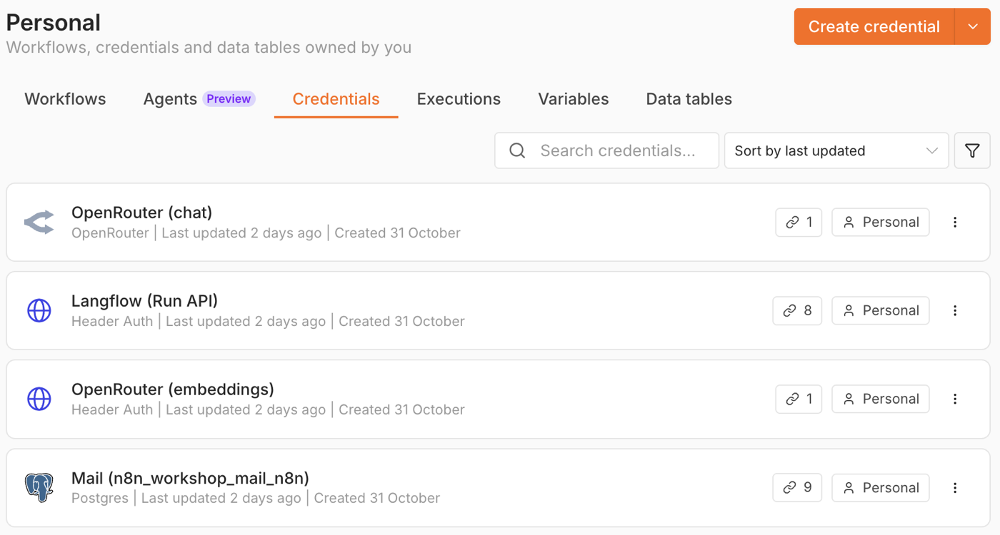

## What you will build in Workshop II

In Workshop II (9, 16 and 23 November), you will build an AI assistant for a real mailbox.

- **The mailbox:** 3,244 real mails of Vince Kaminski. He was head of research at Enron in 2001.
- **Where the mails live:** in a new Gmail account, only for the course. We call it your **test account**.
- **What the AI assistant does:** it reads new mail, sorts it, and drafts answers in Kaminski's words. It sends nothing
  without your OK.

## Your goal for 9 November

At the end of the first morning, this works on your laptop:

1. You will write a mail from your **SKKU mail account** to your test account.
2. Your AI assistant will sort the mail and draft Kaminski's answer.
3. You will read the draft and say OK.
4. The answer will arrive in your SKKU inbox.

<figure class="bp" aria-label="The path of one mail on 9 November"><ol class="bp-path"><li class="bp-stop mail"><span class="bp-disc"><svg viewBox="0 0 24 24" aria-hidden="true"><rect x="3" y="5" width="18" height="14" rx="2"/><path d="m3 7 9 6 9-6"/></svg></span><b>Your SKKU account</b><span>you write to your test account</span></li><li class="bp-stop mail"><span class="bp-disc"><svg viewBox="0 0 24 24" aria-hidden="true"><rect x="3" y="5" width="18" height="14" rx="2"/><path d="m3 7 9 6 9-6"/></svg></span><b>Your test account</b><span>in Gmail: the mail arrives</span></li><li class="bp-stop muscle"><span class="bp-disc"><svg viewBox="0 0 24 24" aria-hidden="true"><rect x="2.5" y="9" width="5" height="6" rx="1.2"/><rect x="16.5" y="3" width="5" height="6" rx="1.2"/><rect x="16.5" y="15" width="5" height="6" rx="1.2"/><path d="M7.5 12H11M11 12V6h5.5M11 12v6h5.5"/></svg></span><b>n8n</b><span>picks it up</span></li><li class="bp-stop brain"><span class="bp-disc"><svg viewBox="0 0 24 24" aria-hidden="true"><path d="M12 3l1.9 4.6 4.6 1.9-4.6 1.9L12 16l-1.9-4.6-4.6-1.9 4.6-1.9z"/><path d="M18.5 15.5l.8 1.9 1.9.8-1.9.8-.8 1.9-.8-1.9-1.9-.8 1.9-.8z"/></svg></span><b>Langflow: Triage</b><span>decides: reply</span></li><li class="bp-stop brain"><span class="bp-disc"><svg viewBox="0 0 24 24" aria-hidden="true"><path d="M12 3l1.9 4.6 4.6 1.9-4.6 1.9L12 16l-1.9-4.6-4.6-1.9 4.6-1.9z"/><path d="M18.5 15.5l.8 1.9 1.9.8-1.9.8-.8 1.9-.8-1.9-1.9-.8 1.9-.8z"/></svg></span><b>Langflow: Draft Reply</b><span>writes in Kaminski's words</span></li><li class="bp-stop muscle"><span class="bp-disc"><svg viewBox="0 0 24 24" aria-hidden="true"><rect x="2.5" y="9" width="5" height="6" rx="1.2"/><rect x="16.5" y="3" width="5" height="6" rx="1.2"/><rect x="16.5" y="15" width="5" height="6" rx="1.2"/><path d="M7.5 12H11M11 12V6h5.5M11 12v6h5.5"/></svg></span><b>n8n</b><span>checks the rules, asks you</span></li><li class="bp-stop person"><span class="bp-disc"><svg viewBox="0 0 24 24" aria-hidden="true"><circle cx="12" cy="8" r="4"/><path d="M4 21c.8-4 4-6.5 8-6.5s7.2 2.5 8 6.5"/></svg></span><b>You</b><span>say OK</span></li><li class="bp-stop hot"><span class="bp-disc"><svg viewBox="0 0 24 24" aria-hidden="true"><rect x="3" y="5" width="18" height="14" rx="2"/><path d="m3 7 9 6 9-6"/></svg></span><b>Your SKKU inbox</b><span>the answer arrives, from your test account</span></li></ol><figcaption><span><i class="bp-key brain"></i>Langflow thinks.</span> <span><i class="bp-key muscle"></i>n8n does the work.</span> <span><i class="bp-key person"></i>You say OK.</span></figcaption></figure>

So you work with two mail accounts: your **SKKU mail account**, which you already have, and a new **test account**
in Gmail, which you make in step 2.

## This homework: three parts

The homework gets your laptop ready for 9 November. It has three parts:

| Part | Steps | What you do |
|---|---|---|
| A | 1–7 | **Set up your test mailbox:** update kingo-pod, make the account, copy Kaminski's mails into it |
| B | 8 | **Test Langflow:** load the course flows, let Triage sort a mail |
| C | 9–13 | **Set up n8n and test it:** logins, mail search, a test mail from your SKKU account |

<figure class="bp bp-setup" aria-label="What this homework sets up"><div class="bp-sys"><div class="bp-node mail "><span class="bp-disc"><svg viewBox="0 0 24 24" aria-hidden="true"><rect x="3" y="5" width="18" height="14" rx="2"/><path d="m3 7 9 6 9-6"/></svg></span><b>Gmail</b><span>your test account</span><em>Part A · steps 1–7</em></div><div class="bp-node box "><span class="bp-disc"><svg viewBox="0 0 24 24" aria-hidden="true"><rect x="3" y="4" width="18" height="7" rx="1.5"/><rect x="3" y="13" width="18" height="7" rx="1.5"/><path d="M7 7.5h.01M7 16.5h.01"/></svg></span><b>Mail</b><span>kingo-pod's service: copies the mails, masks addresses</span><em>Part A · steps 1–7</em></div><div class="bp-node db "><span class="bp-disc"><svg viewBox="0 0 24 24" aria-hidden="true"><ellipse cx="12" cy="5" rx="8" ry="3"/><path d="M4 5v14c0 1.7 3.6 3 8 3s8-1.3 8-3V5"/><path d="M4 12c0 1.7 3.6 3 8 3s8-1.3 8-3"/></svg></span><b>PostgreSQL</b><span>every mail as a row</span><em>Part A · steps 1–7</em></div><div class="bp-node muscle "><span class="bp-disc"><svg viewBox="0 0 24 24" aria-hidden="true"><rect x="2.5" y="9" width="5" height="6" rx="1.2"/><rect x="16.5" y="3" width="5" height="6" rx="1.2"/><rect x="16.5" y="15" width="5" height="6" rx="1.2"/><path d="M7.5 12H11M11 12V6h5.5M11 12v6h5.5"/></svg></span><b>n8n</b><span>does the work</span><em>Part C · steps 9–13</em></div><div class="bp-node brain "><span class="bp-disc"><svg viewBox="0 0 24 24" aria-hidden="true"><path d="M12 3l1.9 4.6 4.6 1.9-4.6 1.9L12 16l-1.9-4.6-4.6-1.9 4.6-1.9z"/><path d="M18.5 15.5l.8 1.9 1.9.8-1.9.8-.8 1.9-.8-1.9-1.9-.8 1.9-.8z"/></svg></span><b>Langflow</b><span>thinks: sorts and drafts</span><em>Part B · step 8</em></div><div class="bp-part pa ">Part A · steps 1–7</div><div class="bp-part pc ">Part C · steps 9–13</div><div class="bp-part pb ">Part B · step 8</div></div><figcaption>What this homework sets up on your laptop: the mails go from Gmail into your database, and n8n and Langflow work with them there.</figcaption></figure>

## Before you start

- **Time:** 1 to 2 hours. Some of it is waiting while things load.
- **Deadline:** **Friday, 6 November**.
- **Stuck?** Write to Frank right away. Then we fix it together.
- **You need:**
  - your kingo-pod;
  - the OpenRouter key Yanbo gave you;
  - the file `ws2_hw.zip`, on Canvas (Workshop II) and at <https://huettner.io/abp/ws2/ws2_hw.zip>. You download it
    in step 8.

## Part A · Set up your test mailbox

<figure class="bp bp-setup bp-mini" aria-label="Where you are: Part A"><div class="bp-sys"><div class="bp-node mail now"><span class="bp-disc"><svg viewBox="0 0 24 24" aria-hidden="true"><rect x="3" y="5" width="18" height="14" rx="2"/><path d="m3 7 9 6 9-6"/></svg></span><b>Gmail</b><span>your test account</span><em>Part A · steps 1–7 · you are here</em></div><div class="bp-node box now"><span class="bp-disc"><svg viewBox="0 0 24 24" aria-hidden="true"><rect x="3" y="4" width="18" height="7" rx="1.5"/><rect x="3" y="13" width="18" height="7" rx="1.5"/><path d="M7 7.5h.01M7 16.5h.01"/></svg></span><b>Mail</b><span>kingo-pod's service: copies the mails, masks addresses</span><em>Part A · steps 1–7 · you are here</em></div><div class="bp-node db now"><span class="bp-disc"><svg viewBox="0 0 24 24" aria-hidden="true"><ellipse cx="12" cy="5" rx="8" ry="3"/><path d="M4 5v14c0 1.7 3.6 3 8 3s8-1.3 8-3V5"/><path d="M4 12c0 1.7 3.6 3 8 3s8-1.3 8-3"/></svg></span><b>PostgreSQL</b><span>every mail as a row</span><em>Part A · steps 1–7 · you are here</em></div><div class="bp-node muscle later"><span class="bp-disc"><svg viewBox="0 0 24 24" aria-hidden="true"><rect x="2.5" y="9" width="5" height="6" rx="1.2"/><rect x="16.5" y="3" width="5" height="6" rx="1.2"/><rect x="16.5" y="15" width="5" height="6" rx="1.2"/><path d="M7.5 12H11M11 12V6h5.5M11 12v6h5.5"/></svg></span><b>n8n</b><span>does the work</span><em>Part C · steps 9–13</em></div><div class="bp-node brain later"><span class="bp-disc"><svg viewBox="0 0 24 24" aria-hidden="true"><path d="M12 3l1.9 4.6 4.6 1.9-4.6 1.9L12 16l-1.9-4.6-4.6-1.9 4.6-1.9z"/><path d="M18.5 15.5l.8 1.9 1.9.8-1.9.8-.8 1.9-.8-1.9-1.9-.8 1.9-.8z"/></svg></span><b>Langflow</b><span>thinks: sorts and drafts</span><em>Part B · step 8</em></div><div class="bp-part pa now">Part A · steps 1–7 · you are here</div><div class="bp-part pc later">Part C · steps 9–13</div><div class="bp-part pb later">Part B · step 8</div></div></figure>

### 1. Update kingo-pod: get the new part called 'Mail'

kingo-pod is the course software on your laptop. Langflow and n8n run in it. This update adds a new part called
**Mail**. It connects your test account to kingo-pod. Later, it also sends the answers you approve.

Open a terminal in your kingo-pod folder and run these two commands, one after the other:

```
./kingo update
```

```
./kingo mode abp
```

- `./kingo update` gets the newest version.
- `./kingo mode abp` starts the parts we need: Langflow, n8n, the PostgreSQL database, CloudBeaver and a service
  called Mail.

This can take a few minutes. You don't have to wait: go on with steps 2 to 5 in your browser. The update keeps running
in the terminal.

### 2. Make your test account in Gmail

1. Go to <https://accounts.google.com/signup>. Google will ask for your phone number.
2. Use this pattern for the address: **`n8n.<givenname>.<familyname>@gmail.com`**
   - For example, for Min-ji Kim: `n8n.minji.kim@gmail.com` (small letters, no spaces, no hyphens)
   - If the address is taken, add a 2: `n8n.minji.kim2@gmail.com`
3. When Google suggests addresses, click **Create your own Gmail address**. Type the part before `@gmail.com`.

This account is only for the course. Do **not** use your private account or your SKKU account: the AI assistant
you build will read and send mail in this account.

### 3. Set your test account to English

In Gmail, signed in with your test account: gear icon → **See all settings** → **General** → **Language**: *English
(US)* → **Save Changes** (at the bottom of the page). Do this before step 6: then the folders in your test account have
English names, as in this guide.

### 4. Turn on 2-Step Verification (needed for step 5)

Go to <https://myaccount.google.com/security> → **2-Step Verification** → turn it on. Choose text messages, the Google
prompt, or an authenticator app. A security key alone does not work for step 5.

### 5. Make an app password for kingo-pod

1. Go to <https://myaccount.google.com/apppasswords>.
2. Type a name for it, for example `kingo mail`, and click **Create**. The name does not matter; it only helps you
   find the password on this page later.
3. Google shows 16 letters, only once. Copy them.

This is not your Google password. It is a second password, only for kingo-pod: with it, kingo-pod can read your test
account and send the answers you approve. You can delete it any time on the same page.

### 6. Connect your test account to kingo-pod

First check that step 1 is done. In the terminal, in your kingo-pod folder, run:

```
./kingo status
```

You should see **Mail** in the list. Then run:

```
./kingo mail
```

It asks three questions:

1. **The address of your test account.** Type the full address, with `@gmail.com`, for example
   `n8n.minji.kim@gmail.com`.
2. **The app password** from step 5. You will not see it while you type.
3. **Other addresses kingo-pod may send mail to.** Type your SKKU address, even if the question says *your
   private one*. On 9 November you will write from your SKKU address, and your AI assistant's answers go back to it.

   **Why?** kingo-pod sends mail only to your test account and the addresses you type here. A mail to anyone
   else lands in your own test account instead. So neither your AI assistant nor a mistake can send mail to
   anyone else.

   **Forgot your SKKU address, or want to add another one later?** Run `./kingo mail` again. Press Enter to keep
   your test account, paste the app password again (or make a new one as in step 5), then type the addresses.

kingo-pod then checks the login. It sends nothing. You should see a line that starts with `OK. Folders:`.

### 7. Copy Kaminski's mails into your test account

Your AI assistant will search Kaminski's old mails for facts when it drafts an answer. The update in step 1 brought
all 3,244 mails onto your laptop, inside kingo-pod. Now you copy them from kingo-pod into your test account.

1. In the terminal, in your kingo-pod folder, run:

   ```
   ./kingo mail seed
   ```

   After a short while, you see a line that starts with `Mailbox:` and ends with `Uploading starts now.`

   **What happens.** In a few seconds, the command puts all mails into kingo-pod's service called Mail, on your
   laptop. Mail keeps this copy: with it, Mail knows what is new on each side. From there, kingo-pod copies the mails
   into its PostgreSQL database and uploads them to your test Gmail account, round by round. In the end, every mail is
   in three places: in Gmail, in Mail, and in PostgreSQL, where n8n and your AI assistant read it.
2. The command is done, but the upload goes on inside kingo-pod for about 30 minutes, sometimes longer. Be patient.
   Keep kingo-pod running and your laptop awake.
3. Watch the mails arrive. They come step by step over the 30 minutes, so the numbers in Gmail grow while you
   watch. Open Gmail in your browser, signed in with your test account. When the upload is done, you see:
   - **Sent** (in the menu on the left): the mails Kaminski wrote, about 1,500.
   - **All Mail** (in the menu on the left, under **More**): all 3,244 mails.
   - **Inbox**: stays empty. That is right: new mail comes in the workshop.

   You can also ask kingo-pod how far it is: run `./kingo mail status`. It shows each folder twice, here and at
   Gmail. When the numbers are the same in every row, the upload is done. (No such rows? Run `./kingo update` first.)
4. You don't have to wait for the upload: go on with Part B now. The upload keeps running in the background.

Good to know:
- `./kingo mail seed` copies every mail only once. If you run it again, kingo-pod answers `already seeded` and gives
  the upload a push.
- If your laptop sleeps or kingo-pod stops, start it again with `./kingo up`. The upload goes on by itself.

## Part B · Test Langflow

<figure class="bp bp-setup bp-mini" aria-label="Where you are: Part B"><div class="bp-sys"><div class="bp-node mail done"><span class="bp-disc"><svg viewBox="0 0 24 24" aria-hidden="true"><rect x="3" y="5" width="18" height="14" rx="2"/><path d="m3 7 9 6 9-6"/></svg></span><b>Gmail</b><span>your test account</span><em>Part A · steps 1–7 ✓</em></div><div class="bp-node box done"><span class="bp-disc"><svg viewBox="0 0 24 24" aria-hidden="true"><rect x="3" y="4" width="18" height="7" rx="1.5"/><rect x="3" y="13" width="18" height="7" rx="1.5"/><path d="M7 7.5h.01M7 16.5h.01"/></svg></span><b>Mail</b><span>kingo-pod's service: copies the mails, masks addresses</span><em>Part A · steps 1–7 ✓</em></div><div class="bp-node db done"><span class="bp-disc"><svg viewBox="0 0 24 24" aria-hidden="true"><ellipse cx="12" cy="5" rx="8" ry="3"/><path d="M4 5v14c0 1.7 3.6 3 8 3s8-1.3 8-3V5"/><path d="M4 12c0 1.7 3.6 3 8 3s8-1.3 8-3"/></svg></span><b>PostgreSQL</b><span>every mail as a row</span><em>Part A · steps 1–7 ✓</em></div><div class="bp-node muscle later"><span class="bp-disc"><svg viewBox="0 0 24 24" aria-hidden="true"><rect x="2.5" y="9" width="5" height="6" rx="1.2"/><rect x="16.5" y="3" width="5" height="6" rx="1.2"/><rect x="16.5" y="15" width="5" height="6" rx="1.2"/><path d="M7.5 12H11M11 12V6h5.5M11 12v6h5.5"/></svg></span><b>n8n</b><span>does the work</span><em>Part C · steps 9–13</em></div><div class="bp-node brain now"><span class="bp-disc"><svg viewBox="0 0 24 24" aria-hidden="true"><path d="M12 3l1.9 4.6 4.6 1.9-4.6 1.9L12 16l-1.9-4.6-4.6-1.9 4.6-1.9z"/><path d="M18.5 15.5l.8 1.9 1.9.8-1.9.8-.8 1.9-.8-1.9-1.9-.8 1.9-.8z"/></svg></span><b>Langflow</b><span>thinks: sorts and drafts</span><em>Part B · step 8 · you are here</em></div><div class="bp-part pa done">Part A · steps 1–7 ✓</div><div class="bp-part pc later">Part C · steps 9–13</div><div class="bp-part pb now">Part B · step 8 · you are here</div></div></figure>

### 8. Test Langflow: load the course flows and let Triage sort a mail

This part checks that Langflow works with the OpenRouter key Yanbo gave you, and with the flows of the course.

We prepared a Langflow flow for you: **Triage (Enron)**. It reads one mail and decides what to do with it: `reply`,
`calendar`, `forward` or `archive`. On 9 November, your AI assistant will use this flow for every new mail. Now you
test it by hand.

Open Langflow: <http://localhost:7860>.

1. **Check your key.** Langflow needs the OpenRouter key Yanbo gave you. Langflow keeps keys as **global variables**:
   you enter a key once, and every flow can use it.
   - Click your profile icon (top right) → **Settings** → **Global Variables**.
   - Is there a variable called `OPEN_ROUTER_API_KEY`? Then go on with 2.
   - If not, click **Add New**. Name: `OPEN_ROUTER_API_KEY`. Type: **Credential** (then Langflow hides the key on
     screen). Value: your key. Save.
   - More help: [Langflow: Global variables](https://docs.langflow.org/configuration-global-variables)
2. **Get the course files.** Download [`ws2_hw.zip`](https://huettner.io/abp/ws2/ws2_hw.zip) (the same file is on
   Canvas, Workshop II) and unzip it. You get a folder
   `ws2_hw` with two folders inside (`langflow` and `n8n`) and a readme. Every name starts with `ws2_`, for
   Workshop II. You need them now and in Part C.
3. **Load the Langflow flows.** Make a new project called `WS2 - Mail Assistant (Enron)`. Open the folder
   `ws2_hw/langflow` (from step 8.2) next to your browser. Select all four files in it and drag them onto the page of
   your new project, where its flows are listed (not into an open flow). Langflow loads all four at once.
   Or use the small button with an arrow pointing up, next to **Projects** in the left column. It says
   *Upload a flow* when you point at it.
4. **Give the flow a mail.** Open the flow `Triage (Enron)`. Copy this mail into the box **Text** of the component
   **Text Input**:

   ```
   From: Thomas Gygax <thomas.gygax@enron.com>
   To: Vince J Kaminski
   Date: Wed, 09 May 2001 03:49:00 GMT
   Subject: Clewlow/Strickland, "Energy Derivatives"

   Dear Vince,

   I'm working in the Continental Power Structured Products group here in London, and we'd like to use the
   Clewlow/Strickland book "Energy Derivatives. Pricing & Risk Management".
   Is there such a thing as an "Enron discount", and if so, how should we purchase the book (two copies) to get it?

   Thanks,
   THOMAS.
   ```

   If you see a yellow note "Legacy" on Text Input or Text Output, ignore it.
5. **Run it.** On the component **Text Output**, click ▶ (*Run component*). Wait a few seconds. Then click the small
   icon next to **Output Text** (*Inspect output*). You see `"action": "reply"` and a short reason after `"why"`.
   Thomas asks a question, so the AI assistant would draft an answer.
6. **Change the mail.** Replace the whole text in **Text Input** with this mail. Run it again:

   ```
   From: Thomas Gygax <thomas.gygax@enron.com>
   To: Vince J Kaminski
   Date: Wed, 09 May 2001 03:49:00 GMT
   Subject: Meeting next Tuesday

   Dear Vince,

   I'm working in the Continental Power Structured Products group here in London. I will be in Houston next week.
   Could we meet on Tuesday at 10 am in your office?

   Thanks,
   THOMAS.
   ```

   Now the action is `calendar`. Thomas wants a meeting, so the AI assistant would mark the mail for the
   calendar.

   Done testing? You can now delete the mail in **Text Input**. On 9 November, n8n will put in each new mail itself.

**Well done: an AI just sorted a real mail for you.** This flow is the brain of your AI assistant. On 9 November, n8n
will give it hands: n8n will notice new mail, then reach out to this Langflow flow, check the answer, and act in your
test account.

## Part C · Set up n8n and test it

<figure class="bp bp-setup bp-mini" aria-label="Where you are: Part C"><div class="bp-sys"><div class="bp-node mail done"><span class="bp-disc"><svg viewBox="0 0 24 24" aria-hidden="true"><rect x="3" y="5" width="18" height="14" rx="2"/><path d="m3 7 9 6 9-6"/></svg></span><b>Gmail</b><span>your test account</span><em>Part A · steps 1–7 ✓</em></div><div class="bp-node box done"><span class="bp-disc"><svg viewBox="0 0 24 24" aria-hidden="true"><rect x="3" y="4" width="18" height="7" rx="1.5"/><rect x="3" y="13" width="18" height="7" rx="1.5"/><path d="M7 7.5h.01M7 16.5h.01"/></svg></span><b>Mail</b><span>kingo-pod's service: copies the mails, masks addresses</span><em>Part A · steps 1–7 ✓</em></div><div class="bp-node db done"><span class="bp-disc"><svg viewBox="0 0 24 24" aria-hidden="true"><ellipse cx="12" cy="5" rx="8" ry="3"/><path d="M4 5v14c0 1.7 3.6 3 8 3s8-1.3 8-3V5"/><path d="M4 12c0 1.7 3.6 3 8 3s8-1.3 8-3"/></svg></span><b>PostgreSQL</b><span>every mail as a row</span><em>Part A · steps 1–7 ✓</em></div><div class="bp-node muscle now"><span class="bp-disc"><svg viewBox="0 0 24 24" aria-hidden="true"><rect x="2.5" y="9" width="5" height="6" rx="1.2"/><rect x="16.5" y="3" width="5" height="6" rx="1.2"/><rect x="16.5" y="15" width="5" height="6" rx="1.2"/><path d="M7.5 12H11M11 12V6h5.5M11 12v6h5.5"/></svg></span><b>n8n</b><span>does the work</span><em>Part C · steps 9–13 · you are here</em></div><div class="bp-node brain done"><span class="bp-disc"><svg viewBox="0 0 24 24" aria-hidden="true"><path d="M12 3l1.9 4.6 4.6 1.9-4.6 1.9L12 16l-1.9-4.6-4.6-1.9 4.6-1.9z"/><path d="M18.5 15.5l.8 1.9 1.9.8-1.9.8-.8 1.9-.8-1.9-1.9-.8 1.9-.8z"/></svg></span><b>Langflow</b><span>thinks: sorts and drafts</span><em>Part B · step 8 ✓</em></div><div class="bp-part pa done">Part A · steps 1–7 ✓</div><div class="bp-part pc now">Part C · steps 9–13 · you are here</div><div class="bp-part pb done">Part B · step 8 ✓</div></div></figure>

n8n is the second tool of the course. In n8n you build **workflows**. A workflow is like a flow in Langflow: boxes
(nodes) joined by lines. The difference: Langflow is good for building AI; n8n is good for doing things. An n8n
workflow starts by itself (for example when a new mail arrives), passes data from box to box, asks Langflow, and acts,
for example in Gmail.

We name our workflows `WS2.0`, `WS2.1`, and so on: `WS2` stands for Workshop II, the number for the step of the
course. `WS2.0` is the first one; you import it in step 10. On 9 November, you will build more.

### 9. Open n8n and give it its logins: four credentials

Langflow and n8n each keep their own keys:
- **Langflow** keeps your OpenRouter key as a global variable (step 8.1). With it, Langflow can use the AI.
- **n8n** keeps its keys and passwords as **credentials**. A credential is a login that n8n saves for you, like an
  entry in a password manager. You make it once, and every workflow that needs it finds it by its name.

n8n needs four credentials. One of them lets n8n use your Langflow flows: for it, Langflow gives n8n a key of its own.

1. **Open n8n and make your account.** Open <http://localhost:5678>. The first time, n8n asks you to make an account.
   It lives only on your laptop.
   - *Set up owner account*: Email (for example the address of your test account), First Name, Last Name, and a
     Password with 8 or more characters, at least 1 number and 1 capital letter. Write the password down: n8n asks for
     it when you sign in again. Click **Next**.
   - *Customize n8n to you*: answer the questions as you like, then click **Get started**.
   - *Get paid features for free (forever)*: click **Skip**. The course does not need them.
   - n8n shows *Sign in* instead? Then you made an account before: sign in with it.
2. **Make a key in Langflow for n8n.** Switch to the browser window of Langflow. There, go to the profile icon in the
   top right → **Settings** → **Langflow API Keys** → **Add New** (top right). In the window *Create API Key*:
   - Description: `n8n`, so you know later what the key is for.
   - If the window also shows an expiration date, leave it empty (*No expiration*). Then the key works for the whole
     course.

   Click **Generate API Key**. Copy the key and keep it somewhere you can find it again: Langflow shows it only once.
   You need it in step 3.
3. **Make the four credentials in n8n.** Now you make four credentials, one after the other: one for kingo-pod's
   database, one for your Langflow flows, and two for OpenRouter. You make each one the same way:
   1. In n8n, click the **+** at the very top left, then **New credential**. A window opens: *Add new credential*,
      *Select an app or service to connect to*.
   2. Type the credential's type into the search box (for example `Postgres`), pick it, and click **Continue**.
   3. **First give the credential its name.** At the top left of the next window, n8n has put a name of its own, for
      example *Postgres account* or *Header Auth account*. Click that name, delete it, and type the name from the list
      below (*Top left*). Use exactly these names: the workflows you import later look for them by name.
   4. Fill in the fields and click **Save** (top right). Then close the window.

   - **Credential 1 of 4: give n8n access to kingo-pod's database**
     - Type: *Postgres*
     - Top left: `Mail (n8n_workshop_mail_n8n)`
     - Host: `postgres`
     - Database: `classroom`
     - User: `n8n_workshop_mail_n8n`
     - Password: `kingo2026`
     - Port: `5432`
     - SSL: `disable`
   - **Credential 2 of 4: give n8n access to your Langflow flows**
     - Type: *Header Auth*
     - Top left: `Langflow (Run API)`
     - Name: `x-api-key`
     - Value: the Langflow key from 2
   - **Credential 3 of 4: give n8n access to OpenRouter, to make the mails searchable (WS2.0)**
     - Type: *Header Auth*
     - Top left: `OpenRouter (embeddings)`
     - Name: `Authorization`
     - Value: type the word `Bearer`, then one space (press the space bar once), then paste your OpenRouter key.
       With your own key, it looks like this: `Bearer sk-or-v1-0a1b2c3d…`
   - **Credential 4 of 4: give n8n access to OpenRouter's chat models, for the guard on 16 November**
     - Type: *OpenRouter*
     - Top left: `OpenRouter (chat)`
     - API Key: your OpenRouter key

   **Why two for OpenRouter?** It is the same key twice. WS2.0 and the guard talk to OpenRouter in two different ways,
   and each way needs the key in its own form.

   **Check:** in the column on the left of n8n, click **Overview**, then the tab **Credentials** (in the middle of the
   page). You see your four credentials:

   

More help: [n8n: Create a credential](https://docs.n8n.io/credentials/add-edit-credentials/)

### 10. Make Kaminski's mails searchable for your AI assistant: import WS2.0

1. In n8n, click **Create workflow**. In the new workflow, open the menu **…** at the top → **Import** → **From file**,
   and pick `ws2_hw/n8n/ws2_0_embed_mails.json` (in the folder from step 8.2).
2. If a node shows a credential warning, pick the credential with the same name.
3. Turn the workflow on: click **Publish** at the top. In the window that opens, click **Publish** again.
   **Publish** means: the workflow now runs by itself, every minute, until you unpublish it.

**What WS2.0 does.** It does not search: it keeps the search up to date. This is a RAG system, like one with
ChromaDB. It stores every mail as an *embedding*: a long list of numbers that stands for what the mail is about. But
this time the store lives in kingo-pod's PostgreSQL database, in the table `chunks`. Every minute, WS2.0 takes up to
320 mails that are not in it yet, gets their embeddings from an AI model on OpenRouter (bge-m3) and saves them there.
So the search knows a new mail soon after it arrives. The first time, all 3,244 mails take about 12 minutes once
step 7 is done.

**Who searches: Langflow.** When your AI assistant needs facts, the component **Mail Search** (in the Langflow flows
Ask Mailbox and Draft Reply) searches in two ways at once:
- **By meaning**, as in any RAG system: it turns the question into numbers in the same way and finds the mails whose
  numbers are closest.
- **By words**: embeddings are bad at finding exact words, such as a name, a number or a rare term. PostgreSQL has an
  index of words, like the index at the back of a book. With it, Mail Search also finds the mails that contain the
  question's words, fast.

Step 13 tests it.

### 11. Check that all mails arrived

When the upload of step 7 is done (about 30 minutes), run this in the terminal, in your kingo-pod folder:

```
./kingo mail status
```

You should see `Mails: 3244 in Postgres` (or a few more) and no `Last error`.

In your test account in Gmail, check two folders:
- **All Mail**: above the list, on the right, Gmail shows *1–50 of 3,244* (or a few more).
- **Sent**: about 1,500 mails.

**Look into the database.** No code needed, just look. CloudBeaver shows the database in your browser:
<http://localhost:8978>. How to log in: [Using CloudBeaver](https://huettner.io/kingo-pod/cloudbeaver/).

1. On the left, open **Classroom (PostgreSQL)** → **Databases** → **classroom** → **Schemas** →
   **n8n_workshop_mail** → **Tables**.
2. Double-click the table **messages**, then click the tab **Data**.
3. One row is one mail of Kaminski's mailbox. Scroll to the right: who sent it (`from_addr`), to whom (`to_addrs`),
   the subject (`subject`), the text (`body_text`).

**Why the addresses look different.** Here in PostgreSQL (on your computer), the addresses end in `.com` or `.edu`, as
in Kaminski's real mails. In Gmail, the same mails have addresses that end in `.example` (for example
`vince.kaminski@enron.example`): no mail can reach such an address. In between, kingo-pod's service called Mail
converts the addresses, both ways:
- **From Gmail to PostgreSQL**, it turns `.example` into the real address. So your AI assistant sees the mails as
  they really were.
- **From PostgreSQL to Gmail**, when your AI assistant sends a mail, it never sends to a real address of the case: a
  mail to one of Kaminski's contacts lands in your own test account instead.

So no mail goes out through Gmail to a real person by mistake. On 9 November, your n8n workflows work with exactly
these rows.

### 12. Check that new mail arrives: a test mail from your SKKU account

From your **SKKU mail account**, send this mail to your test Gmail account. Copy the subject and the text, then
sign with your first name:

```
Kimchi for Monday
```

```
Hi,

This weekend my family makes kimchi for the winter (gimjang).
I will bring a box of it for everyone at the workshop on Monday.
```

Within a minute, it is in the inbox of your test account. kingo-pod also copies it into its database:
`./kingo mail status` now shows one mail more.

You can also see it in CloudBeaver: open the table **messages** as in step 11 and sort it by the column `sent_at`,
newest first. To sort, move the mouse over the head of the column `sent_at`: small arrows appear. Click them until the
newest mail is at the top. Your mail is the first row.

**What just happened.** You sent the mail to Gmail. kingo-pod's service called Mail copied it from Gmail onto your
laptop and put it into the PostgreSQL database. There you can look at it easily, as you just did in CloudBeaver. A
minute later, WS2.0 even adds it to your RAG system (step 10), so Mail Search can find your new mail by what it says.
You try that in step 13.

**It works: the mail from your SKKU account just arrived in kingo-pod on your laptop.**

### 13. Test the mail search: ask the mailbox

We also prepared a Langflow component for you: **Mail Search**. It finds the mails that fit a question, among all
3,244 mails. On 9 November, your AI assistant will use it to find facts for its drafts. The flow **Ask Mailbox (Enron)**
uses it, so you test Mail Search through this flow.

1. In Langflow, open the flow `Ask Mailbox (Enron)` → **Playground**, as usual.
2. Ask: *What is Steve Leppard's email address?* The answer gives steven.leppard@… and names the mail it comes from.
   Here the name *Leppard* helps: Mail Search finds the mail by its words.
3. Now find your own mail from step 12. Ask: *Who is sharing homemade Korean food?* None of these words is in your
   mail, so this time Mail Search finds it by meaning (step 10). The answer tells you about your kimchi.
4. Ask three questions of your own about Kaminski's work in spring 2001.

**That's it: your laptop is ready for 9 November.** There you will build your first n8n workflow, WS2.1, and then
your AI assistant.

## If something goes wrong

| What you see | What to do |
|---|---|
| Triage shows an error (step 8) | Check the name `OPEN_ROUTER_API_KEY` in Langflow. Check that your key still has credit. |
| No app passwords page (step 5) | Turn on 2-Step Verification with text messages or the Google prompt. A security key alone is not enough. |
| `Sign-in failed` (step 6) | Paste the app password again (not your Google password). Check that 2-Step Verification is on. |
| `the mail service is off` | Run `./kingo mode abp`, then step 6 again. |
| `already seeded` (step 7) | Your account already has the mails. Look in Sent and All Mail. |
| The numbers in Gmail stop growing (step 7) | Be patient: kingo-pod uploads in rounds, and Gmail's numbers can stand still for up to 10 minutes. Reload Gmail. Keep your laptop awake. Still no change after 20 minutes? Run `./kingo update`, then `./kingo mail seed` again: it copies nothing twice and gives the upload a push. Still stuck? Send Frank the line `Last error` from `./kingo mail status`. |
| WS2.0 fails at `fetch_embeddings_bge_m3` | In the credential `OpenRouter (embeddings)`, the value must be the word `Bearer`, one space, then your key. |
| Ask Mailbox does not find your kimchi mail (step 13) | WS2.0 adds a new mail a minute after it arrives. Wait a minute and ask again. |
| Ask Mailbox shows `Error building Component Agent` with `Token "NaN" is invalid` (step 13) | Your flows are from before 3 November. Download `ws2_hw.zip` again, delete the four flows in Langflow, and load the four new files (step 8.3). |
| Ask Mailbox gives no answer | WS2.0 is not finished yet (it needs about 12 minutes after step 7), or `OPEN_ROUTER_API_KEY` is missing in Langflow. |
| The Postgres credential fails | Host `postgres` (not `localhost`), SSL `disable`, the password from `.env`. |
| The mail from your SKKU account does not arrive (step 12) | Wait a minute. Check the address. Look into the inbox of your test account in Gmail. |
| `./kingo mail status` shows an error | Copy the error into a mail to Frank. |
| You want to start again with another account | Run `./kingo mail reset`, then step 6 again. |

## The files in ws2_hw.zip

The Enron mail case. Every name starts with `ws2_`, for Workshop II.

The homework says when you need which file (step 8 and Part C).

### Langflow: upload all four in step 8

| File | Langflow flow | What it does |
|---|---|---|
| `langflow/ws2_triage_enron.json` | Triage (Enron) | sorts one mail: MailEx events, action (calendar, reply, forward, archive), deadline |
| `langflow/ws2_draft_reply_enron.json` | Draft Reply (Enron) | drafts Vince Kaminski's reply from his earlier mails, as of the mail's date; never from a confidential mail |
| `langflow/ws2_ask_mailbox_enron.json` | Ask Mailbox (Enron) | answers questions about the mailbox, with sources |
| `langflow/ws2_judge_draft_enron.json` | Judge Draft (Enron) | grades a draft against the reply really sent, 1 to 5 (right from 4); for the test bench of 16 November |

### n8n

| File | n8n workflow | What it does |
|---|---|---|
| `n8n/ws2_0_embed_mails.json` | WS2.0 - Embed Mails | embeds every mail of your mailbox into `n8n_workshop_mail.chunks`, so the search finds it |

### Setting up (short version)

The homework walks you through all of this step by step. The short version, to look things up later:

- Your pod runs in mode `abp`, and your test account is connected and holds Kaminski's mails (`./kingo mail`,
  `./kingo mail seed`).
- In Langflow, your OpenRouter key is a global variable named `OPEN_ROUTER_API_KEY`, with the key Yanbo gave you.

1. **Langflow:** make a project "WS2 - Mail Assistant (Enron)" and upload the four files from `langflow/`. In Settings →
   Langflow API Keys, **Add New** (description `n8n`, no expiration date), then copy the key.
2. **n8n, credentials:** create four, with exactly these names:
   - `Mail (n8n_workshop_mail_n8n)`, type Postgres: host `postgres`, database `classroom`, user
     `n8n_workshop_mail_n8n`, password `kingo2026`, port `5432`, SSL `disable`.
   - `OpenRouter (embeddings)`, type Header Auth: name `Authorization`, value the word `Bearer`, one space, then your
     OpenRouter key.
   - `Langflow (Run API)`, type Header Auth: name `x-api-key`, value your Langflow API key.
   - `OpenRouter (chat)`, type OpenRouter: your OpenRouter key (the guard's model).
3. **n8n, WS2.0:** *Import from File* `n8n/ws2_0_embed_mails.json`; where a node asks for a credential, pick the one of
   the same name. Publish it: it embeds your mailbox, in our test in about 12 minutes.
