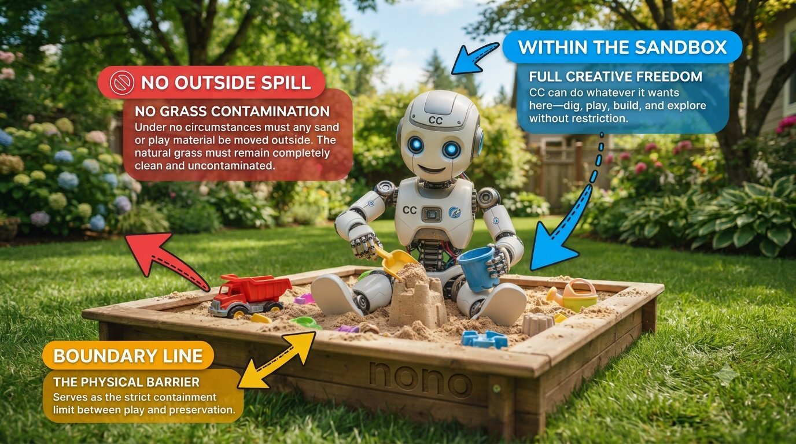

### What is Claude Code?
Claude Code is a major innovation from Anthropic (OpenAI followed up with a clone called Codex; an open source alternative is called OpenCode). The idea is simple (which makes it even better).
1. Instead of copy/pasting code back and forth from Chat interfaces (like ChatGPT or Claude), Claude Code is a tool that simply writes directly onto your computer.
2. Instead of using complicated editors and heavy software, the tool is made to live directly in the terminal. This allowed Anthropic to quickly develop a robust tool, and to focus on the main ideas.
3. Instead of editing code or documents yourself, you describe to the AI what you want to be changed. By design, you use it as an agent.

It started as a simple idea but proved to be revolutionary in software development. Quickly, people also realized
its usefulness for working with other documents, like PowerPoint or Excel files.

### Better safe than sorry
Even though Claude Code usually has good intentions, it might accidentally do things on your computer that have seriously bad consequences. Hence, it’s always asking you for permission before doing something. Quickly, people said yes to everything instead of reading the fine print. Hence, developers decided to build sandboxes: within the sandbox, the AI can do what it wants, it might also reach out on well-defined paths, but that’s it.



We use the sandbox tool called **<a href="https://nono.sh/" target="_blank" rel="noopener">nono</a>**. We configure it so that Claude Code can
- only write in one folder: `~/kingo-pod/claude`,
- read the rest of kingo-pod to understand how it works,
- reach out to n8n, Langflow and your database,
- access the internet, and
- not do anything else on your laptop.

Typically, Claude Code uses the Claude models from Anthropic. Here, we use it with the model GLM 5.3 Flash, paid with the OpenRouter key you already have.

### 1. Update kingo-pod to get the new command `kingo claude`

Open a terminal (in Windows, start WSL/Ubuntu) and run this one line:

```
cd ~/kingo-pod && ./kingo update
```

When it is done, run 
```
./kingo help
```
You should see a line that starts with `kingo claude`.

[Stuck? Help for step 1](#step-1)

### 2. Install Claude Code and its sandbox

One line installs three programs: **nono** (the sandbox), **psql** (so that Claude Code can talk to your Postgres database) and
**Claude Code**. Run the command in the terminal:

On a Mac:

```
brew install nono libpq && curl -fsSL https://claude.ai/install.sh | bash
```

On WSL (Ubuntu in Windows):

```
curl -fsSL https://nono.sh/install.sh | sh && sudo apt install -y postgresql-client && curl -fsSL https://claude.ai/install.sh | bash
```

<details class="more">
<summary>Already using Claude Code?</summary>

Run the command anyway: it installs Claude Code the way Anthropic recommends, or brings it up to date. Your own settings
and your login stay as they are.

Did you install Claude Code with Homebrew or npm instead? Then you now have two installations. `./kingo claude` always takes the new one.
To keep only the new one, remove the old one:

- Homebrew: `brew uninstall --cask claude-code`
- npm: `npm uninstall -g @anthropic-ai/claude-code`

</details>

[Stuck? Help for step 2](#step-2)

### 3. Make a key in n8n

Claude Code works on your workflows through n8n's API. For that, it needs a key from n8n.

1. **Open n8n** at <http://localhost:5678> and sign in.
2. Click **Settings** at the bottom of the left sidebar, then **n8n API**.
3. Click **Create API key**. In the window *Create API Key*:
   - Label: `claude`
   - Expiration: **Never**. Then the key works for the whole course.
4. Click **Save**. Copy the key and keep it for step 4: n8n shows it only once.

[Stuck? Help for step 3](#step-3)

### 4. Start Claude Code and give it its keys

In the terminal, run:

```
cd ~/kingo-pod && ./kingo claude
```

Always start Claude Code for the course this way. A plain `claude` starts a standard Claude Code, without the sandbox
and without the course settings ([what is different](#what-is-different-from-a-standard-claude-code-and-where-it-is-configured)).

The first time, `kingo claude` asks for two keys. You do not see a key as you paste it: that is on purpose.

1. Paste your OpenRouter key (or your group’s key) and press Enter.
2. Paste the n8n key from step 3, and press Enter.

<details class="more">
<summary>Don’t I need to give it a key to Langflow?</summary>

`kingo-pod` can make this and hand it to Claude Code. To be honest, if you have superuser access to the database used by Langflow (and by n8n), and to the file system, then you can get a lot of credentials. Feel free to ask Claude Code more about this later. And while you’re at it, you can ask how an admin can extract credentials saved to n8n.

</details>

Then Claude Code starts and asks a few questions of its own:

3. Pick a theme for Claude Code that you like, and press Enter.
4. *Do you trust the files in this folder?* Choose **Yes**.

You see Claude Code waiting for your first words. Well done: your coding agent is set up.

[Stuck? Help for step 4](#step-4)

### 5. Let’s try it out

Type this and press Enter:

```
List my n8n workflows and tell me in one sentence each what they do.
```

Before Claude Code runs a command, it asks you. Read what it wants to do, then agree. You should see WS2.0,
WS2.1, WS2.3 and WS2.4, each with a sentence. That is Claude Code reading your n8n.

To leave Claude Code (and to get back to the terminal), run
```
/exit
```
Sometimes when exiting Claude Code, you get a question from nono sandbox, if it should give Claude Code further permissions. Only add something if you know what you’re doing.

Now you can continue using this terminal as usual (you can also just open another one like you can open another tab in your browser).

[Stuck? Help for step 5](#step-5)

### 6. See the instructions Claude Code reads at every start

Claude Code reads the file `AGENTS.md` in its folder at every start (actually, it reads `CLAUDE.md` which here just has a link to `AGENTS.md`). You can have a look inside (the `cat` command just prints the content of the file into the terminal and you can continue using the terminal as usual):

```
cat ~/kingo-pod/claude/CLAUDE.md
```
And
```
cat ~/kingo-pod/claude/AGENTS.md
```

With your team's rules in `AGENTS.md`, Claude Code builds the way your team decides: the same names, the same contracts between flows and between tools.

Start Claude Code again with 
```
cd ~/kingo-pod && ./kingo claude
```
and ask:

```
What are our team's rules?
```

Claude Code should say that your team has not added its rules yet. That is right, and it shows that Claude Code has read `AGENTS.md`.

<details class="more">
<summary>How do I change AGENTS.md myself?</summary>

Open it in a text editor, like any text file:

- On a Mac, this line opens it in TextEdit:
  ```
  open -e ~/kingo-pod/claude/AGENTS.md
  ```
- On Windows, in the Ubuntu app, this line opens it in Notepad:
  ```
  cd ~/kingo-pod/claude && notepad.exe AGENTS.md
  ```

Change it, then save with **Cmd+S** (Mac) or **Ctrl+S** (Windows).

Or do it in **nano**, an editor inside the terminal. It works the same on a Mac and in the Ubuntu app. Do not confuse
nano with nono:

- **nano** is the opposite of a huge tool like MS Word for a simple task.
- **nono** is the opposite of saying "yes, yes, …" to Claude Code.

```
nano -w ~/kingo-pod/claude/AGENTS.md
```

(`-w` keeps long lines as they are.)

- Move with the arrow keys, and type as usual. A mouse click does not move the cursor.
- Paste: on a Mac **Cmd+V**, in the Ubuntu app a right click.
- Save: **Ctrl+O** (on a Mac the key *control*, not *command*), then **Enter**.
- Leave nano: **Ctrl+X**.

The two lines at the bottom of nano show these keys: `^O` means **Ctrl+O**.

Claude Code reads `AGENTS.md` only when it starts. After a change, leave Claude Code with `/exit` and start it again.

**Try it:** add this line at the very end of `AGENTS.md`, with your own language if it is not Korean:

```
Always answer me in Korean.
```

Save, `/exit` and start Claude Code again with
```
./kingo claude
```
and ask it something: it answers in Korean. Keep the line, or delete it again. 

It’s a good idea to add your team’s design rules to `AGENTS.md`.
</details>

[Stuck? Help for step 6](#step-6)

### What Claude Code can do, and what it cannot

Careful, if you just type `claude`, then Claude Code runs in the standard way as Anthropic had it set up. Please always use
```
./kingo claude
```
This way, it’s in the nono sandbox.

| Claude Code can | Claude Code cannot |
|---|---|
| read and write in `~/kingo-pod/claude` | write anywhere else on your laptop |
| read kingo-pod: `compose.yml`, the guides | change kingo-pod, or run `./kingo` |
| change your n8n workflows, Langflow flows and database | see your keys: it gets stand-ins |
| look things up on the web | see your own Claude Code settings, if you use Claude Code already |

Sometimes, Claude Code wants to execute a command (which we don’t allow), and then it’ll tell you to run a command on its behalf in the terminal.

**Only run a command in your own terminal if you understand it.**

Claude Code cannot leave its sandbox, but a command you type does. When Claude Code says that the sandbox blocks it, that is the sandbox doing its job. When the sandbox asks you to give additional permissions after leaving Claude Code, then only add something if you know what you’re doing.

### So many requests in a row are tiring, right? Can we tell Claude Code to just do its job?

Claude Code always works in one of four modes. The mode decides who says yes before a command runs: you, the
AI, or nobody. The line under your text shows the mode, for example `⏸ manual mode on`.

**Where can Claude Code change something?** In four places:

- files in its folder `~/kingo-pod/claude`,
- your n8n: workflows and data tables,
- your Langflow flows,
- your Postgres database.

**What about other folders?** Claude Code can read the rest of `~/kingo-pod`, to understand how kingo-pod works.
It cannot write there. And it cannot write into any other folder on your laptop, such as Documents or Desktop. The
nono sandbox stops that, with or without your permission.

So the mode does not decide where Claude Code can write. It decides whether Claude Code asks you first.

**To change the mode, press Shift+Tab.** Each press takes you one mode further, in this order:

1. `manual mode on`: Claude Code asks you before it writes a file and before it runs a command. `./kingo claude`
   always starts here.
2. `accept edits on`: Claude Code writes files in its folder `~/kingo-pod/claude` without asking. Before a command,
   it still asks you.
3. `plan mode on`: Claude Code changes nothing. It writes a plan and asks for your yes.
4. `auto mode on`: the AI decides itself whether it needs to ask you for permission.

One more press of Shift+Tab, and you are back in manual mode.

There is a fifth way, where nobody says yes or no: you start Claude Code with `./kingo yolo` instead of
`./kingo claude`. Then Claude Code never asks for permission.

**The difference, in three examples:**

| What Claude Code wants to do | In manual mode | In accept edits mode | In auto mode | Started with `./kingo yolo` |
|---|---|---|---|---|
| **Write a file:** save its findings in the file `notes.md` in its folder `~/kingo-pod/claude` | Claude Code <strong style="background:#fde68a;color:#1f2937;padding:0 .3em;border-radius:.25em">asks you for permission</strong> first | Claude Code writes the file <strong style="background:#bbf7d0;color:#1f2937;padding:0 .3em;border-radius:.25em">without asking you</strong> | Claude Code writes the file <strong style="background:#bbf7d0;color:#1f2937;padding:0 .3em;border-radius:.25em">without asking you</strong> | Claude Code writes the file <strong style="background:#bbf7d0;color:#1f2937;padding:0 .3em;border-radius:.25em">without asking you</strong> |
| **Run a command that only reads:** list your n8n workflows | Claude Code <strong style="background:#fde68a;color:#1f2937;padding:0 .3em;border-radius:.25em">asks you for permission</strong> first | Claude Code <strong style="background:#fde68a;color:#1f2937;padding:0 .3em;border-radius:.25em">asks you for permission</strong> first | <strong style="background:#bfdbfe;color:#1f2937;padding:0 .3em;border-radius:.25em">The AI checks the command.</strong> If the AI judges it safe, Claude Code runs it <strong style="background:#bbf7d0;color:#1f2937;padding:0 .3em;border-radius:.25em">without asking you</strong>. If not, <strong style="background:#fecaca;color:#1f2937;padding:0 .3em;border-radius:.25em">the command does not run</strong> | Claude Code runs the command <strong style="background:#bbf7d0;color:#1f2937;padding:0 .3em;border-radius:.25em">without asking you</strong>, and <strong style="background:#fecaca;color:#1f2937;padding:0 .3em;border-radius:.25em">the AI does not check it</strong> |
| **Run a command that changes something:** make a copy of a Langflow flow | Claude Code <strong style="background:#fde68a;color:#1f2937;padding:0 .3em;border-radius:.25em">asks you for permission</strong> first | Claude Code <strong style="background:#fde68a;color:#1f2937;padding:0 .3em;border-radius:.25em">asks you for permission</strong> first | <strong style="background:#bfdbfe;color:#1f2937;padding:0 .3em;border-radius:.25em">The AI checks the command.</strong> If the AI judges it safe, Claude Code runs it <strong style="background:#bbf7d0;color:#1f2937;padding:0 .3em;border-radius:.25em">without asking you</strong>. If not, <strong style="background:#fecaca;color:#1f2937;padding:0 .3em;border-radius:.25em">the command does not run</strong> | Claude Code runs the command <strong style="background:#bbf7d0;color:#1f2937;padding:0 .3em;border-radius:.25em">without asking you</strong>, and <strong style="background:#fecaca;color:#1f2937;padding:0 .3em;border-radius:.25em">the AI does not check it</strong> |
| **Write a file outside its folder:** save a file on your Desktop | <strong style="background:#fecaca;color:#1f2937;padding:0 .3em;border-radius:.25em">The nono sandbox stops it</strong>, with or without permission | <strong style="background:#fecaca;color:#1f2937;padding:0 .3em;border-radius:.25em">The nono sandbox stops it</strong>, with or without permission | <strong style="background:#fecaca;color:#1f2937;padding:0 .3em;border-radius:.25em">The nono sandbox stops it</strong>, with or without permission | <strong style="background:#fecaca;color:#1f2937;padding:0 .3em;border-radius:.25em">The nono sandbox stops it</strong>, with or without permission |

**What does this mean for you?** In this homework, Claude Code rarely writes files. It mostly runs commands to
search, and to talk to n8n, Langflow and your Postgres database. In accept edits mode, Claude Code still asks you
before each of these commands. The requests stop only in auto mode, or with `./kingo yolo`.

**Which mode should you use? Auto mode is okay.** Claude Code runs inside the nono sandbox, so the sandbox protects
your laptop in every mode. And every start of `./kingo claude` saves your n8n workflows and your Langflow flows. In
manual mode, you get many requests, and the commands are hard to read. So feel free to switch to auto mode: press
Shift+Tab until the line under your text says `auto mode on`.

Two things to know:

- **In manual mode,** Claude Code asks before each command. **Yes** runs the command. **No** stops Claude Code: then
  tell it what to do instead, or type `continue`.
- **In auto mode,** the AI may refuse a command that you asked for. Then press Shift+Tab until the line under
  your text says `manual mode on`, and send your text again.
- **With `./kingo yolo`,** nobody refuses and nobody asks: Claude Code changes your workflows and flows at once,
  mistakes too. The next section says more.

### You decide: should Claude Code ask before every command?

In each of the four modes, someone checks a command before it runs: you, or a model. You can also start Claude Code
with no check at all. To this end, you start it with this line:

```
./kingo yolo
```

The first time, Claude Code asks whether you accept this mode. Choose **Yes, I accept**.

| | ./kingo claude | ./kingo yolo | claude (without kingo) |
|---|---|---|---|
| Your laptop is | protected by the nono sandbox and by Claude Code’s hesitations | protected by the nono sandbox | protected only by Claude Code’s hesitations: no sandbox |
| Your workflows, flows and database | you see every change before it happens | Claude Code changes them at once, mistakes too | out of reach at first, as Claude Code has no keys for them; but it can read every file you can, your keys too |
| Your user experience | many requests for permissions, often the same ones | Claude Code works on by itself | Anthropic's standard Claude Code: your own Anthropic login and bill, and the usual requests for permissions |

Inside the sandbox, Claude Code’s requests for permission do not protect your laptop: the sandbox does that, with or
without them. They protect your project from Claude Code's mistakes. If you let Claude Code work without asking, save your work first. This line saves your
n8n workflows and your Langflow flows into `~/kingo-pod/backups/` (not your own tables in the database):

```
cd ~/kingo-pod && ./kingo backup
```

On top, every start of `./kingo claude` or `./kingo yolo` saves each n8n workflow and each Langflow flow as one JSON
file in `~/kingo-pod/backups/flows/`. The newest 10 starts stay. You can import such a file again in n8n or in Langflow.

Many people start with the requests for permission and switch once they trust what Claude Code does in their project. It is your choice,
and you can change it at every start.

### What is different from a standard Claude Code, and where it is configured

The Claude Code you started with `./kingo claude` is set up for the course.

<div class="warn">

**And if I just type `claude`?**

Then you get a standard Claude Code with Anthropic's settings: no sandbox, your own `~/.claude`, your own Anthropic
login. Even in `~/kingo-pod/claude`, a plain `claude` runs without the sandbox and without the keys. **Here, you're on
your own, kid.**

The course setup holds only when you start Claude Code with `./kingo claude` or `./kingo yolo`.

</div>

<details class="more">
<summary>In detail: what <code>./kingo claude</code> changes, and where</summary>

What is different from a Claude Code you install and start with `claude`, and the file where each
part is configured:

| | A standard Claude Code | Here, started with `./kingo claude` | Configured for the course in |
|---|---|---|---|
| Start | `claude`, in any folder | `./kingo claude` in the kingo-pod folder; `./kingo yolo` is the same without requests for permission. Claude Code works in `kingo-pod/claude` | `kingo-pod/kingo`, the script behind every `./kingo` command. Before Claude Code starts, it checks that n8n and Langflow run, asks for your keys the first time, copies `AGENTS.md`, `CLAUDE.md` and `.claude/settings.json` into `kingo-pod/claude/` the first time, and writes the nono profile. Then it starts Claude Code inside nono. |
| Model and bill | Claude models, with an Anthropic account or key | GLM 5.3 Flash through OpenRouter, paid with your OpenRouter key | `kingo-pod/claude/.claude/settings.json` names the model, for every role (`ANTHROPIC_MODEL` and the lines `ANTHROPIC_DEFAULT_…_MODEL`). The nono profile sends Claude Code's requests to OpenRouter instead of Anthropic, and puts your OpenRouter key into them. Claude Code does not know this model: `kingo-pod/kingo` tells it the context size to work with (`CLAUDE_CODE_MAX_CONTEXT_TOKENS`), 200,000 tokens. |
| Keys | kept by Claude Code itself | kept in `~/.config/kingo/`; Claude Code sees only stand-ins | `kingo-pod/kingo` asks for your OpenRouter and n8n keys, makes the Langflow key itself, and keeps them in `~/.config/kingo/`, readable only by you. nono reads them from these files when it starts; they are never in an environment variable. The nono profile says, for OpenRouter, n8n and Langflow, which file holds the key and where nono's proxy puts it into a request. |
| Files | Claude Code reads and writes wherever you may, after asking | Claude Code writes only in `kingo-pod/claude` and `~/.kingo-claude`, reads `kingo-pod`, and nothing else; the operating system enforces it | The nono profile `~/.config/nono/profiles/kingo-claude.json` lists the folders Claude Code may read and write, and the few environment variables that reach Claude Code: other keys on your laptop do not. `kingo` writes it anew at every start from `kingo-pod/setup/claude/nono-profile.json`, so a change to it does not last. On top, `kingo-pod/claude/.claude/settings.json` forbids Claude Code to read `.env` files, `~/.ssh` and `~/.aws`. |
| Sandbox | Claude Code's own sandbox, for commands only, if you turn it on | nono, around all of Claude Code: its commands, and its own tools for files too | the nono profile. `kingo-pod/claude/.claude/settings.json` turns Claude Code's own sandbox off (`sandbox.enabled`): nono covers more. |
| Settings and history | `~/.claude` | `~/.kingo-claude`; your own `~/.claude` stays untouched | `kingo-pod/kingo` starts Claude Code with `CLAUDE_CONFIG_DIR=~/.kingo-claude`: Claude Code keeps its settings, sessions and history there. An Anthropic login stored there, `kingo` removes at every start: the course does not use it, and Claude Code could read it. |
| Instructions | a `CLAUDE.md` that you write | `AGENTS.md`: the part about kingo-pod and your team's rules; `CLAUDE.md` only points to it | `kingo-pod/claude/AGENTS.md`, yours to change, and `kingo-pod/claude/CLAUDE.md`, which holds only `@AGENTS.md`. `settings.json` makes Claude Code skip the `CLAUDE.md` of kingo-pod itself, which is for kingo-pod's developers (`claudeMdExcludes`). |
| Memory | hidden in `~/.claude/projects/` | in `kingo-pod/claude/memory/`, where you can read it | `kingo-pod/claude/.claude/settings.json` (`autoMemoryDirectory`) |
| What leaves the laptop | the model's requests and the web pages Claude Code looks up, plus usage data, error reports and feedback to Anthropic; pages on claude.ai (artifacts) and Remote Control, if you use them | the model's requests, to OpenRouter only, and the web pages Claude Code looks up; usage data, error reports, feedback, pages on claude.ai and Remote Control are off | `kingo-pod/kingo` turns off pages on claude.ai, usage data, error reports and all traffic that is not needed, when it starts Claude Code. `kingo-pod/claude/.claude/settings.json` turns off the same, and also feedback (`DISABLE_FEEDBACK_COMMAND`), Remote Control (`disableRemoteControl`), pages on claude.ai (`enableArtifact`) and the check of each web address at Anthropic before Claude Code reads a page (`skipWebFetchPreflight`). |
| A way back | none | every start saves each n8n workflow and Langflow flow as a JSON file in `kingo-pod/backups/flows/`, a folder per start; the newest 10 stay. Claude Code can read them but not change them. A file can be imported again in n8n or in Langflow | `kingo-pod/kingo`, before it starts Claude Code. It needs `psql`. |
| Requests for permission | since version 2.1.283, Claude Code starts in auto mode: a model checks each command, runs what it judges safe and blocks the rest, without asking | Claude Code asks before a command (manual mode). Shift+Tab switches the mode, to auto mode too: there, GLM 5.3 Flash is the judge. `./kingo yolo` turns the requests off | `kingo-pod/kingo` starts Claude Code with `--permission-mode default`, and `./kingo yolo` starts it with `--dangerously-skip-permissions`. The sandbox stays the same. |
| Updates | Claude Code updates itself | no self-update: run the install line again | `kingo-pod/claude/.claude/settings.json`: `CLAUDE_CODE_DISABLE_NONESSENTIAL_TRAFFIC` also turns off the self-update. |

</details>

**Claude Code's memory.** Claude Code writes down for itself what it learns about your project, so that it still knows it
in the next session: for example a name your team chose, or a mistake it should not make again. Usually this memory
is hidden in Claude Code's own folder. Here it lies in `~/kingo-pod/claude/memory/`, so you can read what Claude Code remembers,
and correct or delete it. The file `MEMORY.md` there lists everything it keeps.

Claude Code can explain all of this itself. Ask it:

```
How are you set up here, and what is different from a standard Claude Code?
```

**Next: [Part B · Find out why your mail AI assistant missed the kimchi →](/abp/ws2/hw2-b/)**

## If something goes wrong

Find your step. Still stuck? Write to Frank: then we fix it together.

#### Step 1

| What you see | What to do |
|---|---|
| `./kingo help` shows no `kingo claude` | Run `./kingo update` again and look for errors near the end. Send Frank what `./kingo version` shows. |

#### Step 2

| What you see | What to do |
|---|---|
| `brew: command not found` (Mac) | The line needs Homebrew. It is missing, or your Terminal does not find it. Do [Step 1 — Install Homebrew](https://huettner.io/kingo-pod/mac/#step-1--install-homebrew) of the kingo-pod Mac guide, with its "Next steps" lines. Open a new Terminal window and run the line again. |
| `Unable to locate package` (Windows) | Run `sudo apt update`, then the line again. |
| A download error | Check that you are online, then run the line again. |
| The line says that a folder is not on your PATH | Nothing to do: `./kingo claude` finds the programs anyway. |

#### Step 3

| What you see | What to do |
|---|---|
| You closed the window before you copied the key | Make a new key the same way. In the list on the page *n8n API*, delete the old one. |

#### Step 4

| What you see | What to do |
|---|---|
| `nono is not installed` or `Claude Code is not installed` | Run the line of step 2 again. |
| `Sandbox initialization failed: WSL2: proxy-only network mode cannot be kernel-enforced` (Windows) | Your kingo-pod is too old for Windows. Run `./kingo update`, then step 4 again. After the update, `./kingo version` shows 1.4.6 or newer (on Kingo 1.5: 1.5.5 or newer). |
| `WARNING: WSL2 insecure proxy mode` (Windows) | Nothing to do: on Windows, this line comes at every start. There, the sandbox cannot lock the network, and in this course Claude Code may use the internet anyway. |
| `n8n and Langflow must be running first` | Run `./kingo up`, then step 4 again. |
| `n8n did not accept the key` | Make a new key as in step 3. Then run `./kingo claude` again: it asks for the key. |
| `openrouter did not accept the key` | Check the key Yanbo gave you. Then run `./kingo claude` again: it asks for the key. |
| Claude Code asks you to log in to Anthropic | Do not log in. Type `/exit` and write to Frank. |
| `Model "z-ai/glm-5.3-flash" isn't recognized · context assumed to be 200k tokens` | Nothing to do: Claude Code works. After `./kingo update`, the line no longer comes (`./kingo version` shows 1.4.9 or newer; on Kingo 1.5: 1.5.8 or newer). |
| `removed an Anthropic login` | You logged in to Anthropic inside `./kingo claude`. `kingo` removed that login again: the course does not use it, and Claude Code could read it there. Your own Claude Code login is not affected. |

#### Step 5

| What you see | What to do |
|---|---|
| Claude Code says it cannot reach n8n | Check that n8n opens at <http://localhost:5678>. If not, run `./kingo up` in your own terminal, then ask again. |
| Claude Code does not ask before it runs a command, and the line under your text says `auto mode on` | Your kingo-pod is too old: there, a newer Claude Code starts in auto mode, where a model decides which commands run. It may refuse things that you asked for. Type `/exit`, run `./kingo update`, then `./kingo claude`. The line under your text then says `manual mode on`, and `./kingo version` shows 1.4.9 or newer (on Kingo 1.5: 1.5.8 or newer). |

#### Step 6

| What you see | What to do |
|---|---|
| `No such file or directory` | `./kingo claude` makes these files at its first start. Do step 4 first. |
